# MEDVERSE Africa

**Interactive 3D medical education for every African student: explore the human body,
dissect it virtually, watch it work, and learn with an AI tutor, on an ordinary device.**

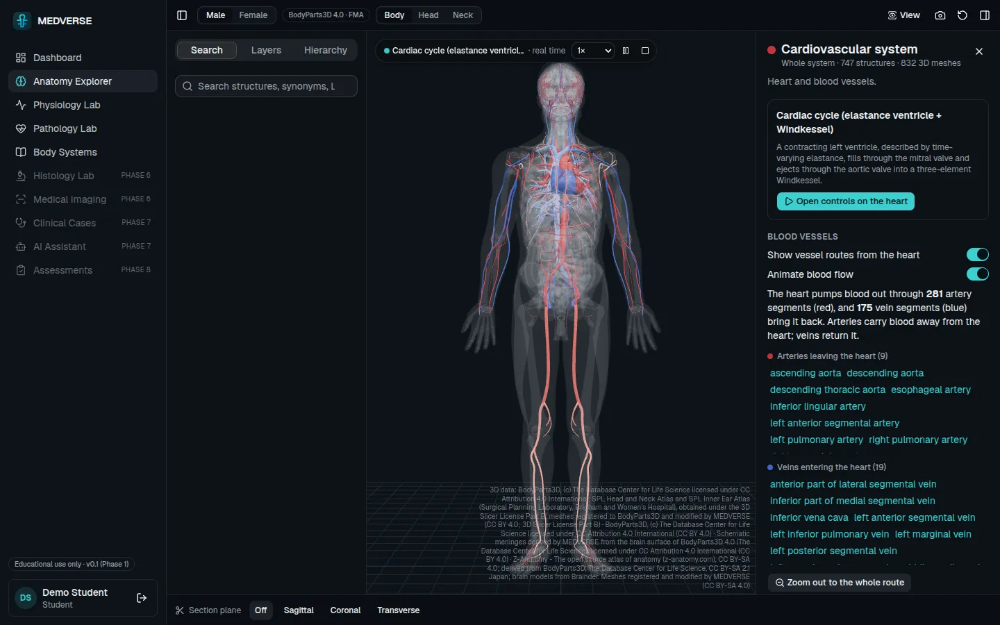

> **Educational use only.** MEDVERSE is not a diagnostic or treatment tool. Curated content
> is marked *draft* until a credentialed expert has reviewed it, and every simulation is a
> simplified educational model that states its assumptions and sources.

## Why MEDVERSE exists

Across Africa, medical, nursing and allied-health students often study without anatomy
laboratories, physical specimens, simulation equipment or up-to-date learning resources.
Where these exist, they are expensive and concentrated in a few institutions.

**A student's ability to become an excellent healthcare professional should not depend on
whether they can afford expensive medical education infrastructure.**

MEDVERSE uses 3D visualisation, interactive simulation and artificial intelligence to close
that gap. Students explore the body in detail, dissect it layer by layer, see how its
systems work, and (as the platform grows) learn with an AI medical tutor that explains
concepts, sets assessments and runs clinical scenarios.

### Our approach: African-first

| Pillar | What it means |
|---|---|
| **Multilingual** | Medical education in the student's language, starting with English and Swahili. |
| **Offline and low-bandwidth** | Works on limited, expensive or intermittent mobile data, and without a connection. |
| **Affordable 3D** | Detailed anatomy that runs on ordinary phones and laptops, not lab workstations. |
| **Locally relevant** | Clinical scenarios built around the conditions students will actually treat. |
| **Personalised AI** | Learning adapted to medical, nursing and allied-health students and their level. |

The goal is a better-equipped healthcare workforce across Africa.

## What you can do today

| Sign in | Your home page: continue learning, quick actions, progress by system |
|---|---|
| 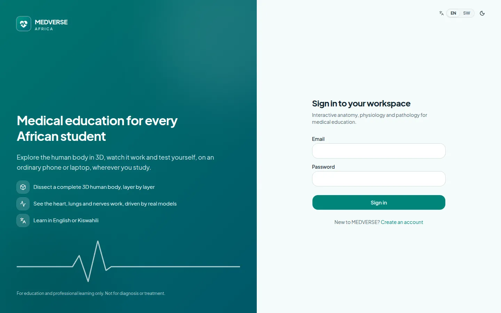 | 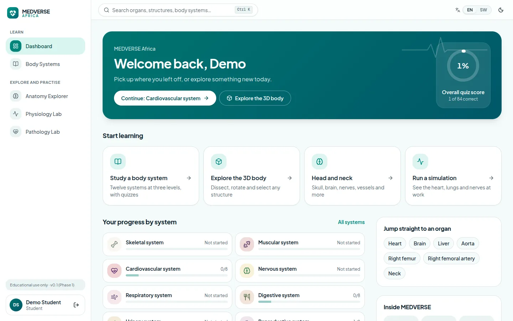 |

A clean, light clinical design (with a dark mode for night study), a search box that
finds any organ, structure or body system from every page (Ctrl K), and an English /
Kiswahili switch.

### Explore and dissect the human body in 3D

Two complete bodies, male and female, built from about **1,950 and 1,380 independently
selectable 3D parts** and linked to some 2,500 anatomical structures identified with the
Foundational Model of Anatomy (FMA) and named in Terminologia Anatomica 2. Search, browse the hierarchy, show or fade any of 12 body systems,
dissect layer by layer, cut sections in any anatomical plane, isolate, compare structures
and see blood-vessel routes from any organ. Each structure has an information panel with
its Latin name, location, function, relations and clinical relevance, all referenced.

### Study the head and neck in depth

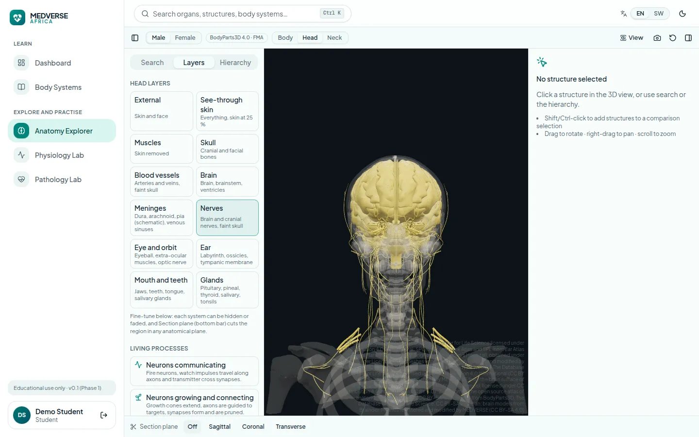

Dedicated **Head** and **Neck** study modes frame the region and offer one-click layers:
skin, muscles, skull, vessels, brain, meninges, cranial nerves, eye and orbit, ear, mouth
and teeth, glands, larynx, cervical spine, viscera and lymph nodes. The head includes all
twelve cranial nerves with their branches and nuclei, the dural venous sinuses, facial
muscles, the inner ear and the paranasal sinuses.

| Female head (skull and muscles fitted from a male-derived model, clearly labelled) | Neck: the baroreceptor reflex, step by step |
|---|---|
| 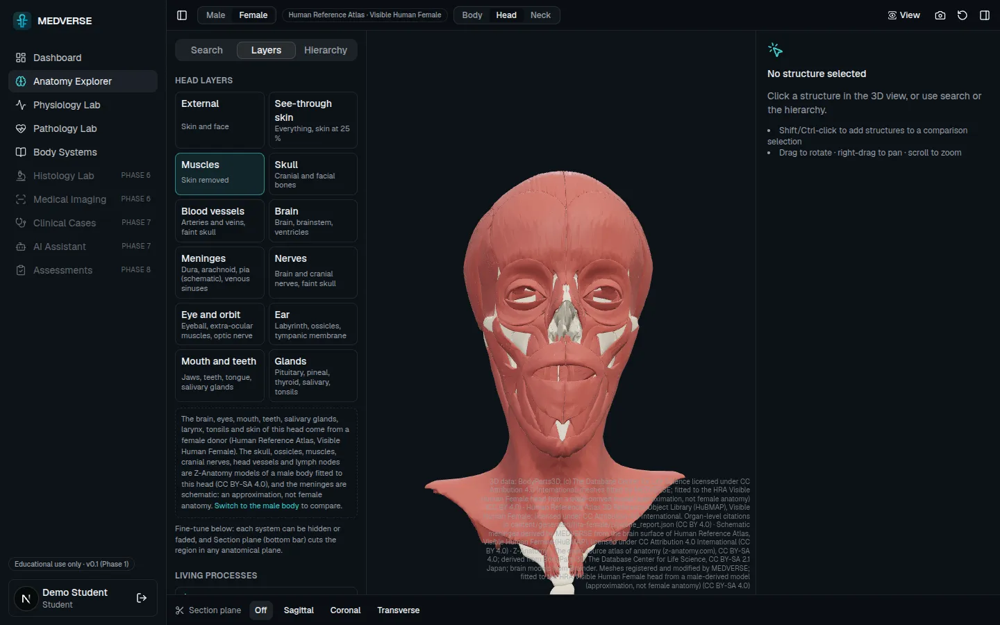 | 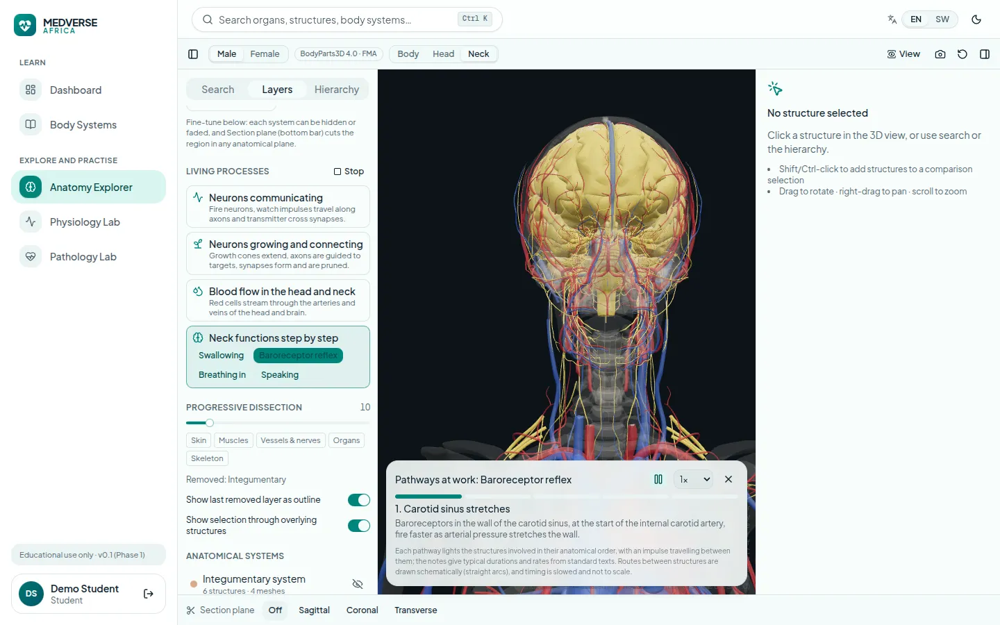 |

Where no open female dataset exists, structures are fitted from a male-derived model and
**labelled as an approximation**, never presented as female anatomy.

### Learn body systems, with the 3D model and simulations beside the text

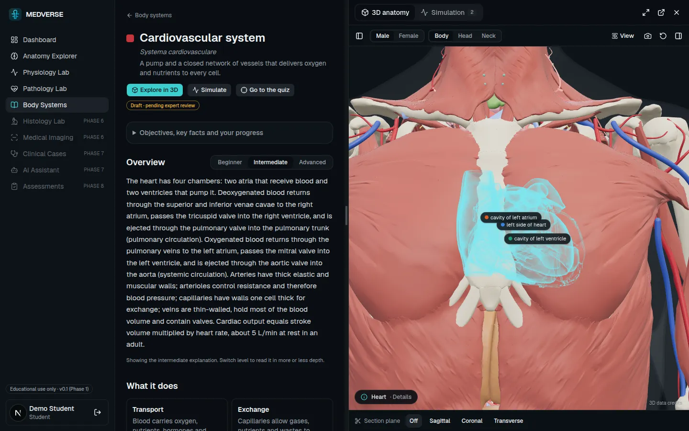

Twelve body-system modules, each written at **beginner, intermediate and advanced** level,
cover functions, main organs, how the system works with others, key terms with their word
origins, and clinical relevance, followed by a quiz (84 questions, including "find it in
3D" questions answered on the model). Opening the 3D model or a simulation keeps you in the
module: it appears in a resizable panel beside the explanation, or full-screen on a phone.

| Run a simulation next to the explanation | Neurons communicating, in slow motion |
|---|---|
| 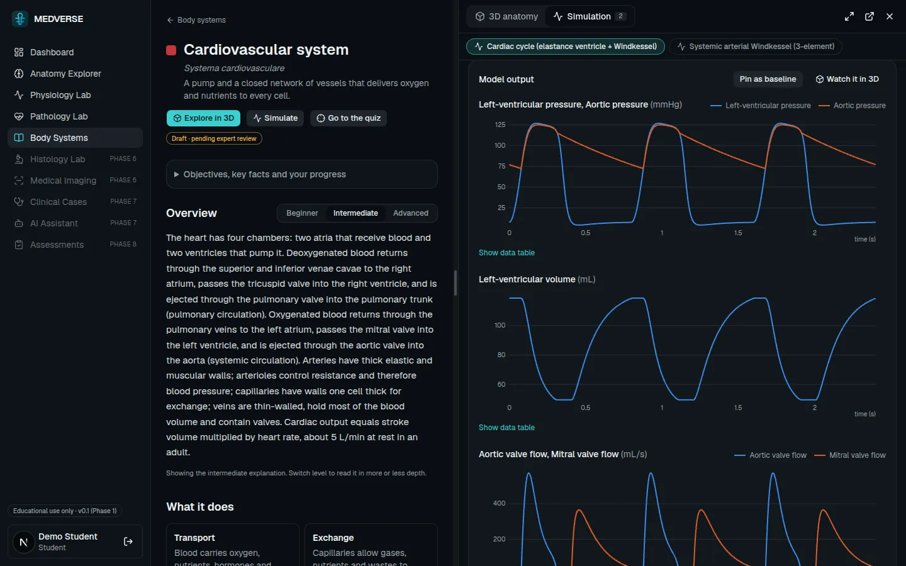 | 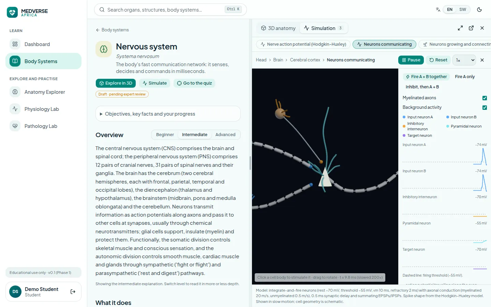 |

### See the body work

- **Physiology lab**: documented, tested models: the cardiac cycle with a pressure–volume
  loop, the arterial Windkessel, breathing mechanics and the Hodgkin–Huxley nerve action
  potential. Change a parameter, compare with a baseline, and watch the result drive the 3D
  heart, lungs or nerves.
- **Living processes**: blood flowing through the vessels of the head and neck, neurons
  firing and forming connections, and step-by-step pathways for seeing, hearing, moving,
  touch, swallowing, breathing in, speaking and the baroreceptor reflex. Each states what
  is modelled and what is a schematic.
- **Pathology lab**: compare healthy and abnormal states (arterial stiffening, raised
  peripheral resistance).

<p align="center">
  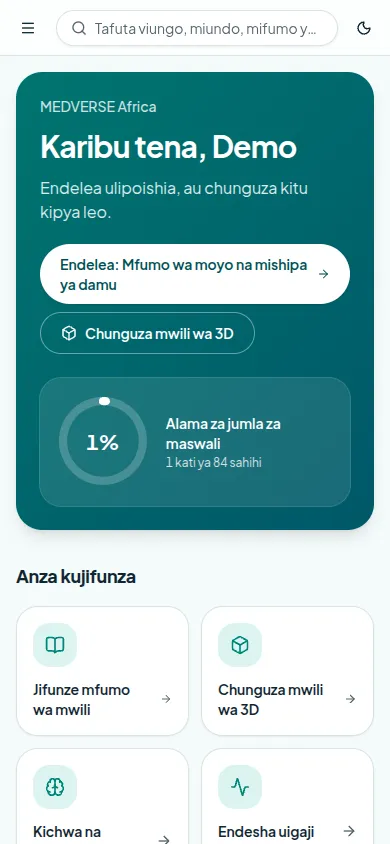
  &nbsp;
  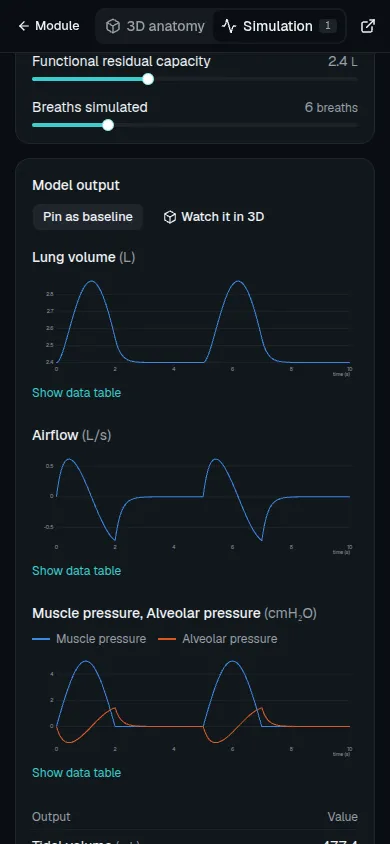
</p>

The interface works at phone width (here in Kiswahili); the 3D views and simulations adapt
to the space they are given.

## Status and next steps

MEDVERSE is in **Phase 1 (foundation)**. See [docs/roadmap.md](docs/roadmap.md) for what
works and what does not.

**Next: the African-first foundations**, built before more body regions are added because
they get harder to retrofit:

1. **English and Swahili.** Translation for the interface and the content format, so every
   new structure, module and pathway is written in both languages from the start.
2. **Lighter 3D and offline use.** A low-data version of the models, loading only the
   region being studied, an installable app with downloadable modules and quizzes, and
   download sizes shown before anything large loads.
3. **An AI tutor grounded in our referenced content.** It explains, quizzes and runs
   clinical cases using only the curated material and its sources, with answers labelled
   as AI-generated. Clinical scenarios start with malaria, tuberculosis, HIV, sickle cell
   disease, maternal and newborn care, and trauma.

Then the **chest**, abdomen, pelvis and limbs follow, in both languages and within the
download-size limits.

**In progress:** English and Kiswahili ([languages](docs/i18n.md)): the interface shell,
dashboard and learning hub are bilingual, and every module's title, objectives and
beginner overview is in Kiswahili (draft translation, pending review).

**Not available yet:** offline use, the AI tutor, clinical cases, histology and
medical imaging. These appear in the app as planned features.

## How we build it

- **Accuracy first.** Every curated statement cites a standard reference (Gray's Anatomy,
  Moore's Clinically Oriented Anatomy, Guyton and Hall, OpenStax). Content stays *draft*
  until expert review ([content governance](docs/content-governance.md)).
- **Honest simulations.** Models document their equations, assumptions, validated range
  and sources. Animations that are schematic say so.
- **Open, licensed 3D data.** All anatomy comes from openly licensed datasets, credited in
  the app and below; no proprietary models are copied.

## Quick start

Prerequisites: Docker, Python ≥ 3.12, Node 22.

```bash
docker compose up -d db redis

cd backend
python3 -m venv .venv && .venv/bin/pip install -e ".[dev]"
cp .env.example .env
.venv/bin/alembic upgrade head
.venv/bin/python -m app.seed --demo-users     # loads content/, creates demo accounts
.venv/bin/uvicorn app.main:app --reload --port 8000

cd ../frontend
npm ci
npm run dev                                   # http://localhost:3000
```

Demo accounts (development only; the seeder refuses to create them in production):
`student.demo@example.org`, `doctor.demo@example.org`, `lecturer.demo@example.org`,
`institution.admin.demo@example.org`, `content.expert.demo@example.org`,
`platform.admin.demo@example.org`. Password: `Medverse-Demo-2026!`

API documentation: http://localhost:8000/api/v1/docs. To run MEDVERSE on a server, see the
[deployment manual](docs/deployment.md).

## Tests

```bash
cd backend && .venv/bin/pytest && .venv/bin/ruff check app tests ../pipeline   # 125 tests, uses the medverse_test DB
cd frontend && npm test && npm run lint && npm run typecheck && npm run build   # 63 tests
```

## Repository

| Path | Contents |
|---|---|
| `backend/` | FastAPI service: authentication, anatomical knowledge graph, simulation engine, learning modules, pathology |
| `frontend/` | Next.js 16 app: 3D anatomy engine (React Three Fiber), learning hub, physiology and pathology labs |
| `pipeline/` | Builds the 3D bodies and their knowledge records: `bodyparts3d/` (male), `hra/` (female), `spl/` (atlas registration), `zanatomy/` (head and neck supplement), `meninges/` (schematic meninges). See [3D assets](docs/3d-asset-pipeline.md) |
| `content/` | Version-controlled references, systems, curated anatomy, learning modules, quizzes, pathology and generated data |
| `docs/` | [Architecture](docs/architecture.md) · [Database](docs/database.md) · [Knowledge graph](docs/knowledge-graph.md) · [3D assets](docs/3d-asset-pipeline.md) · [Simulation](docs/simulation-engine.md) · [API](docs/api.md) · [Security](docs/security.md) · [Deployment](docs/deployment.md) · [Languages](docs/i18n.md) · [Governance](docs/content-governance.md) · [Roadmap](docs/roadmap.md) |

## 3D data and licences

| Source | Used for | Licence |
|---|---|---|
| [BodyParts3D 4.0](https://dbarchive.biosciencedbc.jp/en/bodyparts3d/), The Database Center for Life Science | Male body | CC BY 4.0 (see the [licence note](frontend/public/assets/anatomy/bp3d-4.0/LICENSE.md)) |
| [Human Reference Atlas](https://humanatlas.io/), Visible Human Female (HuBMAP) | Female body | CC BY 4.0, with per-organ citations |
| SPL Head and Neck and Inner Ear atlases, Surgical Planning Laboratory, Brigham and Women's Hospital | Head and ear structures registered to the male skull | [3D Slicer License, Part B](frontend/public/assets/anatomy/bp3d-4.0/LICENSE-3D-Slicer-Part-B.txt) |
| [Z-Anatomy](https://www.z-anatomy.com), derived from BodyParts3D, with Brainder brain models | Head and neck supplement for both bodies | CC BY-SA 4.0, kept in separate bundles ([notice](frontend/public/assets/anatomy/zanatomy/LICENSE.txt)) |
| MEDVERSE, derived from each body's brain surface | Schematic cranial meninges | CC BY 4.0 (as derivatives of the sources above) |

The licence for MEDVERSE's own code has not been chosen yet.
