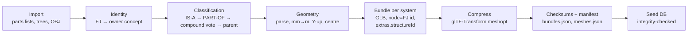

# 3D asset pipeline

## Current source: BodyParts3D 4.0 (PART-OF, 99 % polygon reduction)

| Metric | Value |
|---|---|
| Concepts (structures) | 1,368 |
| Mesh elements (FJ files) | 1,258, all built |
| Triangles | ≈ 3.1 M |
| Bundles | 12 per-system GLBs, 13 MB total (meshopt + quantised; 42 MB raw) |
| Unclassified meshes | 0 (33 regional compound concepts such as "trunk" stay "Regional structures") |
| Model | adult male only |

Not present in this source subset: peripheral nerves (the IS-A set contains some cranial
nerves), lymph nodes/vessels, female anatomy, microscopic structures, textures.

## Running

```bash
# 1. Download from https://dbarchive.biosciencedbc.jp/en/bodyparts3d/download.html into SRC:
#    partof_parts_list_e.txt, partof_inclusion_relation_list.txt, partof_element_parts.txt,
#    isa_inclusion_relation_list.txt, partof_BP3D_4.0_obj_99.zip (unzipped)
backend/.venv/bin/python pipeline/bodyparts3d/build.py --source SRC
# 2. Re-seed
cd backend && .venv/bin/python -m app.seed
```

## Stages



1. **Identity.** Each OBJ header names its concept (`# Concept ID : FMA…`); that is
   authoritative. A tree-derived owner (most specific concept containing the element) is
   computed as a cross-check; 11 disagreements are recorded in `pipeline_report.json`.
2. **Classification.** (a) IS-A kind against `systems.json:isa_fma` (bone organ → skeletal,
   vein → cardiovascular, lens → special senses…); (b) PART-OF lineage against `source_fma`;
   (c) compounds take the system of ≥ 75 % of their meshes; (d) inherit from the nearest
   classified PART-OF ancestor. All mapping data is in `content/systems.json` for review.
3. **Geometry.** BodyParts3D is mm, +x patient-left, +y posterior, +z superior. Output is
   metres, Y-up, facing +Z: `(x, y, z) → (x, z, −y)·0.001` (det +1, laterality preserved),
   feet at y = 0. Normals are omitted and computed on the client.
4. **Bundles.** One GLB per system → progressive loading and per-system visibility.
   Node and mesh names are element IDs; `extras.structureId` and (vascular) `extras.group`
   (`artery`/`vein`/`heart`, derived from FMA lineage) are rendering hints.
5. **Compression.** `@gltf-transform/cli@4.2.1 meshopt` (EXT_meshopt_compression +
   KHR_mesh_quantization). Verified to preserve names and extras.
6. **Manifest.** SHA-256 and size per bundle; a test fails if a GLB is missing or its
   checksum differs from `bundles.json`.

## Runtime loading

- `GET /api/v1/assets/manifest` → bundles + `meshId → [bundleId, structureId]`.
- Each bundle loads under its own Suspense boundary (progressive); BVH built per mesh for picking.
- `Cache-Control: public, max-age=86400` on `/assets/anatomy/*`.

## Roadmap

- Object storage + CDN with content-hashed paths; asset versioning per dataset release.
- LOD: use the 95 %-reduction BodyParts3D variant (or meshoptimizer simplification) as a
  low-bandwidth tier; choose by device/network.
- Commercial or licensed assets (female anatomy, peripheral nerves, lymphatics) through the
  same pipeline: import → map to structure IDs → validate → review → bundle.
- Quality review: per-mesh screenshot sheets for anatomist sign-off before release.
- Cross-sectional caps (stencil) for clipping planes; currently cut surfaces are open.
