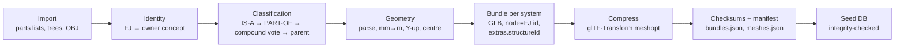

# 3D asset pipeline

MEDVERSE has two complete, separately sourced 3D bodies. They share one knowledge graph
(structure IDs, content, search, quizzes) but no geometry: the female body is not a
modified copy of the male body.

| Body | Source | Licence | Meshes | Triangles | Bundles |
|---|---|---|---|---|---|
| Male | BodyParts3D 4.0 (whole-body segmentation, FMA IDs) | CC BY 4.0 | 1,258 | ≈ 3.1 M | 12 GLBs, 13 MB |
| Female | Human Reference Atlas 3D reference organs, Visible Human Female (HuBMAP) | CC BY 4.0 (checked per organ) | 872 | ≈ 2.0 M | 10 GLBs, 7.7 MB |

Each bundle row carries `body_model` (`male` / `female`); `GET /assets/manifest?model=`
serves one body and `GET /assets/models` lists both with per-system coverage.

### Coverage by system

| System | Male | Female |
|---|---|---|
| Skeletal | whole skeleton | pelvis (hip bones, sacrum, coccyx), femur, tibia, fibula, patella, sternum, intervertebral discs |
| Muscular | trunk, girdle and eye muscles, diaphragm | — (no open female muscle source) |
| Cardiovascular | heart, great vessels, systemic arteries and veins | heart (chambers, valves), named arteries and veins incl. uterine and ovarian vessels |
| Nervous | brain, spinal cord | brain (283 atlas regions), spinal cord by segment |
| Respiratory | trachea, bronchial tree, lungs | larynx, trachea, bronchi, lungs by bronchopulmonary segment |
| Digestive | mouth to rectum, liver, pancreas, gallbladder | mouth and teeth, liver, pancreas, small and large intestine, omentum (no oesophagus or stomach) |
| Urinary | kidneys, ureters, bladder, urethra | kidneys (cortex, pyramids, papillae), renal pelvis, ureters, bladder |
| Reproductive | prostate | uterus (fundus, body, cervix, walls), uterine tubes, ovaries, breasts |
| Endocrine | pituitary, pineal, suprarenal glands | — |
| Lymphatic | thymus | thymus, spleen, palatine tonsils, a mesenteric lymph node |
| Integumentary | skin | skin |
| Special senses | eyes, lacrimal apparatus | eyes (cornea, lens, retina, vitreous …) |

The UI states the gaps where they matter: systems a body lacks are listed as "Not in the
female body's 3D source", and a structure that exists only in the other body (e.g. the
prostate or the uterus) offers "Show in the male/female body". Vessel routes
(`/circulation`) are computed from the male contact graph and are offered for the male
body only.

## Male body: BodyParts3D 4.0 (PART-OF, 99 % polygon reduction)

| Metric | Value |
|---|---|
| Concepts (structures) | 1,368 |
| Mesh elements (FJ files) | 1,258, all built |
| Triangles | ≈ 3.1 M |
| Bundles | 12 per-system GLBs, 13 MB total (meshopt + quantised; 42 MB raw) |
| Unclassified meshes | 0 (33 regional compound concepts such as "trunk" stay "Regional structures") |
| Model | adult male only |

Not present in this source subset: peripheral nerves (the IS-A set contains some cranial
nerves), lymph nodes/vessels, female anatomy, microscopic structures, textures.

## Running

```bash
# 1. Download from https://dbarchive.biosciencedbc.jp/en/bodyparts3d/download.html into SRC:
#    partof_parts_list_e.txt, partof_inclusion_relation_list.txt, partof_element_parts.txt,
#    isa_inclusion_relation_list.txt, partof_BP3D_4.0_obj_99.zip (unzipped)
backend/.venv/bin/python pipeline/bodyparts3d/build.py --source SRC
# 2. Re-seed
cd backend && .venv/bin/python -m app.seed
```

## Stages



1. **Identity.** Each OBJ header names its concept (`# Concept ID : FMA…`); that is
   authoritative. A tree-derived owner (most specific concept containing the element) is
   computed as a cross-check; 11 disagreements are recorded in `pipeline_report.json`.
2. **Classification.** (a) IS-A kind against `systems.json:isa_fma` (bone organ → skeletal,
   vein → cardiovascular, lens → special senses…); (b) PART-OF lineage against `source_fma`;
   (c) compounds take the system of ≥ 75 % of their meshes; (d) inherit from the nearest
   classified PART-OF ancestor. All mapping data is in `content/systems.json` for review.
3. **Geometry.** BodyParts3D is mm, +x patient-left, +y posterior, +z superior. Output is
   metres, Y-up, facing +Z: `(x, y, z) → (x, z, −y)·0.001` (det +1, laterality preserved),
   feet at y = 0. Normals are omitted and computed on the client.
4. **Smoothing.** BodyParts3D is only distributed at 99 % polygon reduction, which leaves
   visible facets. Each mesh gets 3 passes of Taubin λ|μ smoothing (λ = 0.5, μ = −0.53),
   which removes facets without the shrinkage of Laplacian smoothing (volume change
   < 0.1 % on a test sample). Open-rim vertices are pinned and every vertex's
   displacement is capped at min(2 mm, 1.5 % of the mesh extent), so thin structures keep
   their shape (`--smooth-iterations 0` disables it). The contact graph is computed from
   the unsmoothed source geometry.
5. **Bundles.** One GLB per system → progressive loading and per-system visibility.
   Node and mesh names are element IDs; `extras.structureId` and (vascular) `extras.group`
   (`artery`/`vein`/`heart`, derived from FMA lineage) are rendering hints.
6. **Compression.** `@gltf-transform/cli@4.2.1 meshopt` (EXT_meshopt_compression +
   KHR_mesh_quantization). Verified to preserve names and extras.
7. **Manifest.** SHA-256 and size per bundle; a test fails if a GLB is missing or its
   checksum differs from `bundles.json`.

## Mesh contact graph (`pipeline/bodyparts3d/adjacency.py`)

Run after `build.py` with the same `--source`. For every pair of meshes whose bounding
boxes (expanded by 10 mm) overlap, it records the minimum vertex-to-vertex distance if
≤ 10 mm → `content/generated/bodyparts3d/mesh_adjacency.json`, and writes each
cardiovascular mesh's `render_group` (artery / vein / heart, from the FMA lineage) into
`meshes.json`. Seeded into `mesh_contacts` and `meshes.render_group`.

The graph is **geometric inference, not curated anatomy**. The API uses it to trace
likely vessel routes (`GET /anatomy/structures/{id}/circulation`): breadth-first search
from the vessels touching the heart, over artery-only or vein-only meshes linked within
2 mm, to the vessels within 4 mm of the structure. Known failure modes: a vessel merely
passing close by appears as a supply; gaps in decimated meshes break routes (reported as
`unrouted_vessels`); crossing vessels of the same class can create shortcuts. The UI
labels routes "Inferred from 3D geometry" and shows this explanation.

## Runtime loading

- `GET /api/v1/assets/manifest` → bundles + `meshId → [bundleId, structureId]`.
- Each bundle loads under its own Suspense boundary (progressive); BVH built per mesh for picking.
- `Cache-Control: public, max-age=86400` on `/assets/anatomy/*`.

## Roadmap

- Object storage + CDN with content-hashed paths; asset versioning per dataset release.
- LOD: use the 95 %-reduction BodyParts3D variant (or meshoptimizer simplification) as a
  low-bandwidth tier; choose by device/network.
- Commercial or licensed assets (female anatomy, peripheral nerves, lymphatics) through the
  same pipeline: import → map to structure IDs → validate → review → bundle.
- Quality review: per-mesh screenshot sheets for anatomist sign-off before release.
- Cross-sectional caps (stencil) for clipping planes; currently cut surfaces are open.

## Female body: Human Reference Atlas, Visible Human Female (`pipeline/hra/`)

```bash
backend/.venv/bin/python pipeline/hra/fetch.py --dest SRC   # downloads + organ licences
backend/.venv/bin/python pipeline/hra/build.py --source SRC
cd backend && .venv/bin/python -m app.seed
```

1. **Inputs** (`fetch.py`): the HRA reference-organ catalogue and female scene
   (`apps.humanatlas.io/api/v1`), the ASCT+B 3D crosswalk (node name → UBERON/FMA), the
   45 female organ GLBs, each organ's dataset metadata (licence, DOI citation) and
   Uberon (`uberon-base.obo`, used only for UBERON → FMA cross-references). Downloads are
   parsed as data; nothing downloaded is executed.
2. **Licence gate.** Every organ dataset must declare CC BY 4.0; otherwise the build
   stops. Organ citations and DOIs are written to `pipeline_report.json`.
3. **Selection.** 43 organ files are used. The full-term placenta (pregnancy-specific)
   and the subcutaneous adipose sample blocks are excluded.
4. **Identity.** Each mesh node is mapped through the crosswalk. FMA terms are used
   directly; UBERON terms become FMA when Uberon lists exactly one FMA cross-reference,
   so the female heart, kidneys, liver … are the *same structures* as in the male body
   (152 shared). Other terms become new structures (384, FMA or UBERON CURIEs) named
   from the crosswalk label of the node that maps to them. Unmapped nodes (mostly fine
   brain-atlas parcels) belong to their nearest mapped ancestor or their organ.
   Laterality comes from term labels only. A non-lateral part present in both the left
   and right organ (e.g. "kidney capsule") is placed under the two organs' nearest
   common ancestor, and every mesh also belongs to the organ of its file, so selecting
   "right kidney" selects all of its meshes.
5. **Systems.** The organ file decides the system (a lung segment is respiratory even
   where the male source classed the same FMA term otherwise); vessel nodes inside any
   organ are cardiovascular. Breasts are layered with the reproductive organs so that
   the skin can be hidden independently (TA2 lists the breast with the integument, as
   the learning content says).
6. **Geometry.** The HRA scene is metres, Y-up, facing +Z, patient's left = +X: the
   MEDVERSE convention. Organ placements are applied; the body is translated so the
   feet rest on y = 0 (height 1.658 m). Vertices are welded and each organ is
   simplified with meshoptimizer (`gltf-transform simplify`, max error 0.4 % of extent)
   to a per-organ budget (e.g. brain 180 k, vasculature 220 k triangles; 7.5 M → 2.0 M
   in total), then bundled per system and meshopt-compressed as for the male body.

## Head (male body supplements, `pipeline/bodyparts3d/supplements.py`)

The head is being completed before other regions. Two supplements are merged into the
male BodyParts3D build, so they share its coordinate frame and final transform:

```bash
backend/.venv/bin/python pipeline/bodyparts3d/build.py --source SRC \
  --isa-source ISA_DIR \                    # unzipped isa_BP3D_4.0_obj_99.zip
  --spl-head-neck head-neck-2016-09.zip \   # openanatomy.org/atlases/nac/
  --spl-inner-ear inner-ear-2018-02.zip
```

1. **BodyParts3D IS-A elements** (same dataset, CC BY 4.0). Meshes that exist only in the
   IS-A tree and whose centroid lies above a floor 40 mm below the mandible are added,
   except generic subdivisions ("region of", "wall of" …) and neck muscles. Each element
   is owned by its most specific IS-A concept; a part-of parent is inferred from the name
   ("branch of left middle cerebral artery" → "left middle cerebral artery") when that
   structure exists. Structures carry `identity_source = bodyparts3d-4.0-isa`.
2. **SPL atlases** (Surgical Planning Laboratory, Brigham and Women's Hospital; 3D Slicer
   License Part B). From the Head and Neck atlas: temporalis, masseter, zygomaticus
   major, parotid glands, external carotid arteries and thyroid gland. From the Inner Ear
   atlas: bony labyrinth, round window, malleus, incus, stapes, tympanic membrane, tensor
   tympani, stapedius and the facial, cochlear and vestibular nerves.
   *Registration* (`pipeline/spl/register.py`): the atlas skull + mandible are registered
   onto the 22 BodyParts3D cranial and facial bones (symmetric trimmed ICP: similarity,
   then affine with singular values bounded to 0.85–1.18 of the similarity scale); the
   inner-ear atlas's temporal bone onto each BodyParts3D temporal bone with a uniform
   scale only (its units are about 2.4× millimetres, and an affine fit would distort the
   small ear structures). The atlas is a right ear; the left ear is its mirror image.
   Residual surface distances are written to `pipeline_report.json`
   (`supplements.spl_registration`); see the coverage table below for current values.
   Structures carry `identity_source = spl-atlas`; the licence text (with the required
   preface and a statement that the meshes are modified) ships as
   `frontend/public/assets/anatomy/bp3d-4.0/LICENSE-3D-Slicer-Part-B.txt`, and affected
   bundles list both licences.

### Z-Anatomy head supplement (both bodies, `pipeline/zanatomy/`)

[Z-Anatomy](https://www.z-anatomy.com) (CC BY-SA 4.0; itself derived from BodyParts3D,
CC BY-SA 2.1 Japan, with Brainder brain models) fills the remaining head gaps. Its files
are **share-alike**, so they are built into their own bundles
(`frontend/public/assets/anatomy/zanatomy/{male,female}-<system>.glb`, licence
`CC BY-SA 4.0`, notice in `LICENSE.txt` there), separate from the CC BY 4.0 bundles.

```bash
# once per FBX from github.com/LluisV/Z-Anatomy (Resources/Models/FBX), Blender 4.2 LTS:
blender --background --factory-startup --python pipeline/zanatomy/blender_export.py \
  -- SkeletalSystem100.fbx GLB_DIR/skeletal.glb   # also muscular, nervous, cardio, visceral, lymphoid
backend/.venv/bin/python pipeline/zanatomy/build.py --glb-dir GLB_DIR
```

- **Selection** (`selection.json`, 226 entries): every Z-Anatomy mesh in the head
  was compared with the male build by FMA concept (present with geometry or not) and by
  surface overlap with the BodyParts3D/SPL meshes; only missing structures are kept.
  Names were mapped to FMA terms (left/right where FMA has them) from the FMA ontology.
  Brain gyri/sulci and cerebellar lobules are not used (they duplicate the cortex).
- **Male**: Z-Anatomy is built on the same body, so its skull is registered onto the
  built male skull by a similarity transform (median 1.23 mm, p90 5.03 mm, scale 1.027).
  Structures carry `identity_source = z-anatomy`; mesh ids start with `ZAM-`.
- **Female**: Z-Anatomy has no female anatomy. The same meshes are fitted to the HRA
  female head with a bounded affine transform estimated from brain, both scleras, upper
  and lower teeth and thyroid cartilage (median residual 3.2–5.8 mm per anchor). They are
  labelled everywhere (bundle attribution, structure panel, head-layers notice) as fitted
  from a male-derived model, not female anatomy; mesh ids start with `ZAF-`. Structures
  the female already has (brain, eyes, mouth, larynx, ophthalmic vessels) are never added.
- **BodyParts3D meshes fitted to the female** (`female_fitted_bodyparts3d` in the
  selection): the external ear, laryngeal muscles and ligaments the female model lacks
  are copied from the built male body and fitted with the same transform. They stay
  CC BY 4.0 (`female-fitted-bp3d-*.glb`, bundle ids `fitted-*`, mesh ids `FIT-`).
- Z-Anatomy meshes are welded and simplified (meshoptimizer, 30 % ratio with an error
  cap); total for both bodies about 0.83 M triangles.

### Schematic cranial meninges (`pipeline/meninges/`)

No open dataset segments the cranial dura, arachnoid or pia, so they are derived from
each body's own brain surface with Blender (`blender_meninges.py`): the pia is a 1 mm
voxel remesh offset 0.3 mm (it follows the gyri), the arachnoid and dura a 5 mm voxel
envelope (bridging the sulci) offset 1.5 and 2.5 mm. They are teaching schematics of
where the layers lie (`identity_source = medverse-derived`, render groups `dura`,
`arachnoid`, `pia`), CC BY 4.0 as derivatives of BodyParts3D / HRA. The viewer hides
them except in the head "Meninges" preset or when one is selected, since they enclose
the brain.

```bash
backend/.venv/bin/python pipeline/meninges/build.py --blender /path/to/blender
```

### Head coverage (current)

Registration residuals: head-and-neck atlas median 3.25 mm / 90th percentile 6.64 mm;
inner ear right 4.08 / 11.49 mm, left (mirrored) 4.07 / 10.99 mm; Z-Anatomy see above.
"ZA" = Z-Anatomy; on the female body ZA meshes are fitted from a male-derived model.

| Group | Male body | Female body | Still missing |
|---|---|---|---|
| Brain and CNS | lobes, gyri, cerebellum, brainstem, thalamus, hypothalamus, basal nuclei, limbic structures, ventricles, falx and tentorium (ZA), cranial nerve nuclei (ZA), spinal cord; dura, arachnoid, pia (schematic) | 283 atlas regions, spinal cord by segment; falx and tentorium (ZA); dura, arachnoid, pia (schematic) | segmented (non-schematic) meninges |
| Cranial nerves | I–XII incl. trigeminal divisions and branches (ZA for I, III, V, VI, VII, IX–XII) | I–XII (ZA) | small autonomic ganglia branches |
| Eye | eyeball layers, lens, retina, optic nerve, chiasm, tract, extra-ocular muscles, lacrimal apparatus, tarsal plates | eyeball layers (female donor); extra-ocular muscles, optic nerve, lacrimal apparatus, tarsal plates (ZA) | — |
| Vessels | carotid and vertebral systems, circle of Willis and cortical branches, dural venous sinuses, facial, scalp, maxillary and orbital vessels, jugular veins (ZA for sinuses, facial/scalp/maxillary vessels, EJV) | orbital vessels (female donor); carotids, vertebral, basilar, circle of Willis, sinuses, facial and scalp vessels, jugular veins (ZA) | cortical branches on the female body |
| Skull | 14 cranial and facial bones, hyoid, conchae, teeth; frontal, sphenoidal and ethmoidal sinuses, jaw joint disc, capsule and ligaments (ZA) | full skull, hyoid, atlas, axis, nasal cartilages, sinuses, jaw joint (ZA); teeth (female donor) | third molars |
| Muscles | all expression, mastication and scalp muscles, cricothyroid (ZA), extra-ocular, tongue, supra/infrahyoid, pharyngeal, laryngeal, neck | expression, mastication, extra-ocular, suprahyoid, pharyngeal, suboccipital and neck muscles, cricothyroid (ZA); laryngeal muscles (fitted BodyParts3D) | — |
| Ear | external ear; labyrinth, ossicles, tympanic membrane, middle-ear muscles, VII/VIII (SPL); auditory tube (ZA) | external ear (fitted BodyParts3D); ossicles, cochlea, tympanic membrane, auditory tube (ZA) | — |
| Nose, mouth, pharynx | septum, conchae, tongue, palate, salivary glands and ducts, pharynx regions, nasal mucosa (ZA), larynx | mouth, teeth, tongue, palate, salivary glands, larynx, tonsils (female donor); parotid duct, pharynx regions, nasal mucosa (ZA) | — |
| Glands, lymph | pituitary (with adeno/neurohypophysis, ZA), pineal, thyroid, parathyroids (ZA), head lymph nodes (ZA) | pineal, thymus (female donor); parathyroids, head lymph nodes (ZA) | buccal and orbital fat pads (no open source) |

### Head study mode (UI)

The Body/Head switch (or `/anatomy?region=head`) adds a horizontal clipping plane 0.40 m
below the vertex (head plus upper neck: hyoid, larynx, thyroid), hides meshes entirely
below it, frames the camera on the head, scales the section plane to the head and
offers head layer presets (external, see-through skin, muscles, skull, vessels, brain,
meninges, nerves, eye and orbit, ear, mouth and teeth, glands). Picking ignores clipped
geometry.

## Rendering

- Image-based lighting from a procedural studio room (three.js `RoomEnvironment`, no
  download), plus warm key, cool fill and rim lights; ACES tone mapping.
- Surface finishes per tissue class: matte bone, moist viscera with a thin clearcoat,
  smoother vessels and eyes (`engine/materials.ts`). Colours remain the system palette.
- Selection: a soft tint on the structure plus a Fresnel rim "x-ray" overlay drawn
  through occluding anatomy, so deep structures read as 3D shapes.
- Switching body remounts the scene (fresh mesh registry); bundles stay cached, the
  selected structure is kept and re-framed in the new body.
