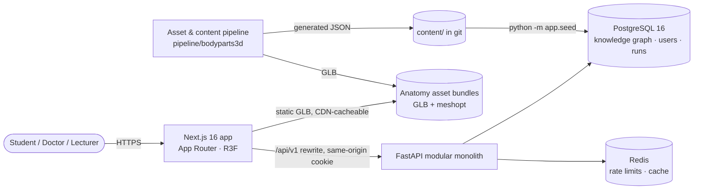
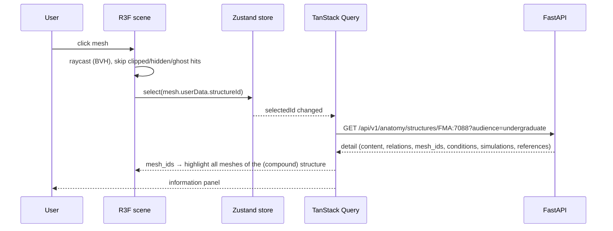

# MEDVERSE system architecture

Status: Phase 1 (foundation) implemented. This document describes what exists **and**
the target shape; sections marked *(planned)* are not built yet.

## 1. Principles

| Principle | How it is enforced |
|---|---|
| Modular monolith first | One FastAPI service with domain packages (`anatomy`, `simulation`, `pathology`, `identity`). Extract services only when load or team boundaries justify it. |
| Knowledge ≠ geometry ≠ physiology | Anatomical facts live in PostgreSQL (seeded from `content/`); geometry lives in GLB bundles; equations live in `backend/app/simulation`. They meet only through **structure IDs**. |
| One identifier everywhere | `FMA:<n>` CURIEs are the primary key in the DB, the `extras.structureId` of every GLB node, the API path segment and the client store key. |
| Honest provenance | Every structure, relationship, content section and condition carries `verification_status`; content and models carry an evidence class (A–D). Nothing is marked reviewed without a recorded reviewer. |
| Computation server-side | Simulations run in Python; the browser only renders results. |

## 2. System context



## 3. Runtime components

| Component | Tech | Responsibility |
|---|---|---|
| `frontend/` | Next.js 16 (App Router, Cache Components), React 19, TypeScript strict, Tailwind 4, shadcn/ui (Radix), R3F 9 + drei 10, three r187, Zustand, TanStack Query, Zod | UI shell, 3D engine, panels, labs |
| `backend/` | Python 3.13, FastAPI, Pydantic 2, SQLAlchemy 2, Alembic, psycopg 3, NumPy | REST + WebSocket API, auth/RBAC, knowledge graph, simulation engine |
| `pipeline/` | Python + NumPy, glTF-Transform (pinned) | Source dataset → knowledge records + per-system GLB bundles |
| `content/` | Version-controlled JSON | References, systems, curated anatomy, pathology, generated BodyParts3D records |
| PostgreSQL 16 | `pg_trgm` | System of record |
| Redis 7 | | Rate limiting (fallback: in-process) |

## 4. Repository layout

```
medverse/
├── backend/
│   ├── app/
│   │   ├── api/v1/          auth, anatomy (+assets), references, simulations (+WS), pathology
│   │   ├── core/            config, security (argon2, tokens), rbac, errors, rate_limit
│   │   ├── db/              engine/session, declarative base + naming convention
│   │   ├── models/          identity, anatomy (graph + assets), clinical, enums
│   │   ├── schemas/         Pydantic API contracts
│   │   ├── services/        auth_service, anatomy_service (search, graph traversal)
│   │   ├── simulation/      core abstractions, solvers, registry, models/windkessel.py
│   │   └── seed/            content loader (integrity-checked), demo users
│   ├── alembic/             migrations
│   └── tests/               API, auth, RBAC, integrity, scientific validation
├── frontend/src/
│   ├── app/                 (auth)/login|register, (app)/dashboard|anatomy|physiology|pathology, proxy.ts
│   ├── components/          ui/ (shadcn), shell/, brand/
│   ├── features/
│   │   ├── anatomy/         store.ts, engine/ (scene, canvas, materials, palette), panels/
│   │   ├── physiology/      chart, model docs, lab
│   │   ├── pathology/       lab
│   │   ├── governance/      verification/evidence badges, references, disclaimers
│   │   └── auth/, dashboard/
│   └── lib/api/             typed client, wire types, TanStack Query hooks
├── pipeline/bodyparts3d/    build.py
├── content/                 references, systems, anatomy/curated, pathology, generated/
├── infra/postgres/init/     extensions, test DB
├── docs/
└── docker-compose.yml, .github/workflows/ci.yml
```

## 5. Request flow: selecting a structure



## 6. Decision log (ADRs, abbreviated)

| # | Decision | Rationale | Consequence |
|---|---|---|---|
| 1 | **BodyParts3D 4.0** as first anatomy asset source | Segmented per-structure meshes keyed by FMA IDs; open licence (see §7) | Adult male only; no peripheral nerves/lymphatics in the PART-OF set; 99 %-reduced meshes |
| 2 | CURIE IDs (`FMA:7088`) as primary keys | Stable, external, already present in source data; namespace allows non-FMA sources later (`MV:`) | Path segments contain `:` (URL-encoded by the client) |
| 3 | Opaque server-side sessions (hashed in DB) instead of JWT | Immediate revocation, no key rotation burden; same token works as Bearer for API clients | One DB lookup per request (indexed); move to Redis cache if needed |
| 4 | Same-origin API via Next.js rewrite | First-party httpOnly SameSite=Lax cookie, no CORS for browsers | Production needs the rewrite or an ingress routing `/api` |
| 5 | Per-system GLB bundles, meshopt + quantisation | Progressive loading per system; 42 MB → 13 MB; node names/extras preserved | Client needs meshopt decoder (drei default) |
| 6 | Visibility per mesh, materials shared by appearance | ~1,300 meshes; avoids per-mesh material explosion | Material cache keyed by colour/state/opacity |
| 7 | Simulations in Python, fixed-step RK4 | Deterministic, testable against analytic results; scientific code in one place | Interactive latency ≈ 20 ms per run for WK3 |
| 8 | Content as versioned JSON + idempotent seeder | Reviewable diffs, CI integrity checks, reproducible DBs | Authoring UI and approval workflow are Phase 3 |
| 9 | Enums stored as VARCHAR + CHECK | Extensible without `ALTER TYPE` | Validation in app layer too |
| 10 | Classification of meshes into systems from IS-A then PART-OF lineage | The PART-OF tree is regional (limbs, trunk); IS-A gives kind (bone organ, vein) | Mapping table in `content/systems.json` is reviewable |

## 7. Asset licensing

BodyParts3D's README (updated 2025-02-25) states **CC BY 4.0**; individual OBJ headers still
contain the earlier **CC BY-SA 2.1 Japan** text. MEDVERSE attributes per the README, displays
attribution in the viewer, and treats derived GLBs conservatively (share-alike) until DBCLS
confirms. **Action required before commercial release:** written confirmation from DBCLS.

## 8. Scalability path *(planned)*

- Assets → object storage + CDN, content-hashed URLs, KTX2 when textures are introduced.
- Read-heavy anatomy endpoints → Redis response cache keyed by content version.
- Simulation workloads beyond interactive WK3 → Celery workers; WebSocket streams progress.
- Multi-tenant data → `institution_id` scoping in services + PostgreSQL row-level security.
