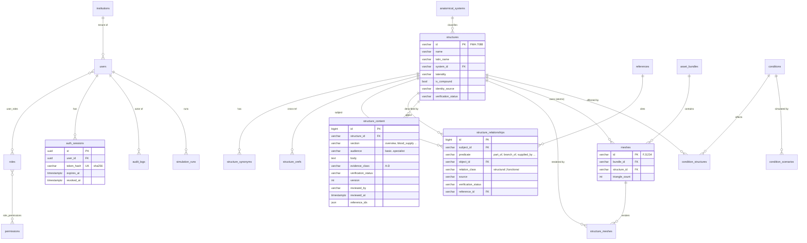

# Database schema

PostgreSQL 16, managed by Alembic (`backend/alembic/versions`). Enums are VARCHAR + CHECK.
Extensions: `pg_trgm` (fuzzy search).

## Entity relationship diagram (implemented)



Also: `simulation_runs (model_id, model_version, parameters JSON, summary JSON, duration_ms)`,
`audit_logs (action, actor, target, ip, details JSON)`.

## Indexes

- `structures.name`, `structure_synonyms.synonym`: GIN trigram (`gin_trgm_ops`) for search.
- FKs on relationship subject/object, structure_content.structure_id, meshes.bundle_id/structure_id.
- Unique: `(subject_id, predicate, object_id)`, `(structure_id, section, audience)`, `users.email`, `auth_sessions.token_hash`.

## Planned entities

| Phase | Entities |
|---|---|
| 3 (knowledge) | `content_revisions`, `reviews` (reviewer, credentials, decision), `tissues`, `cells`, landmark/region tables |
| 5 (pathology) | `injuries`, `clinical_findings`, `investigations` |
| 6 (histology/imaging) | `histology_images`, `imaging_studies/series/instances` (de-identified only) |
| 7 (AI) | `ai_interactions` (prompt, retrieved sources, model, user, feedback) |
| 8 (LMS) | `courses`, `modules`, `assessments`, `questions`, `attempts`, `results`, `notes`, `bookmarks`, `flashcards`, `review_schedule` |
| 9 (enterprise) | `departments`, `groups`, `subscriptions`; row-level security on all tenant tables |

## Migrations

```bash
cd backend
.venv/bin/alembic revision --autogenerate -m "describe change"
.venv/bin/alembic upgrade head
```

Tests rebuild the `medverse_test` database from migrations on every run, so a broken
migration fails CI.
