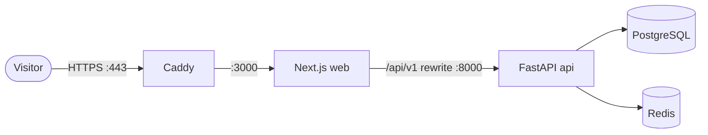

# Deployment manual

How to run MEDVERSE on the public internet: one Linux server, the existing Docker Compose
stack, and Caddy in front for HTTPS.

## Overview



Only Caddy is reachable from the internet. Everything else stays on Docker's private
network.

What the repository already provides:

| Piece | Where |
|---|---|
| Production backend image (non-root, `--proxy-headers`) | `backend/Dockerfile` |
| Production frontend image (Next.js standalone build) | `frontend/Dockerfile` |
| Same-origin API through a rewrite, so browsers never call the API host directly | `frontend/next.config.ts` |
| Full stack in containers | `docker-compose.yml`, profile `app` |
| Secure cookies and HSTS when `MEDVERSE_ENV=production` | `app/api/v1/auth.py`, `app/main.py` |
| Seeder refuses demo accounts in production | `app/seed/__main__.py` |

What this manual adds: production settings, a Compose override, a Caddyfile, and
operating procedures. None of these files exist in the repository yet. Create them as you
follow the steps.

## Requirements

| Item | Minimum | Notes |
|---|---|---|
| Server (VPS) | 2 vCPU, **4 GB RAM**, 40 GB disk, Ubuntu 24.04 | The Next.js build is memory-heavy. Hetzner, DigitalOcean and Linode all fit. Roughly $10–25 a month. |
| Domain | one | About $10–15 a year at most registrars |
| Software on the server | Docker Engine with Compose v2.24 or later | v2.24 is needed for `!reset` in the override file |

## 1. Prepare the server

```bash
ssh root@SERVER_IP
adduser deploy && usermod -aG sudo deploy        # day-to-day user
rsync -a ~/.ssh /home/deploy/ && chown -R deploy:deploy /home/deploy/.ssh
curl -fsSL https://get.docker.com | sh           # Docker Engine + Compose plugin
usermod -aG docker deploy
```

Then, in `/etc/ssh/sshd_config`, set `PasswordAuthentication no` and `PermitRootLogin no`,
and run `systemctl restart ssh`. Log in as `deploy` from then on.

Firewall:

```bash
sudo ufw allow 22 && sudo ufw allow 80 && sudo ufw allow 443
sudo ufw enable
```

> Docker writes its own iptables rules, so a port published in Compose is reachable **even
> when ufw blocks it**. The real protection is step 4, which stops publishing the
> database ports.

## 2. Point the domain at the server

At your registrar, add DNS records (replace the IP):

| Type | Name | Value |
|---|---|---|
| `A` | `@` | `SERVER_IP` |
| `A` | `www` | `SERVER_IP` (optional) |

Check it with `dig +short medverse.org` before step 6. Caddy can only get a certificate
once DNS resolves to the server.

## 3. Get the code and write production settings

```bash
git clone git@github.com:malise5/medverse.git
cd medverse
openssl rand -base64 32        # use the output as POSTGRES_PASSWORD
```

Create `.env` in the repository root, next to `docker-compose.yml`. Compose reads it for
variable substitution. It is never committed (`.env` is git-ignored; confirm with
`git check-ignore .env`).

```dotenv
# /home/deploy/medverse/.env — production secrets, never commit
DOMAIN=medverse.org
POSTGRES_PASSWORD=<output of openssl rand>
```

Production values for the API, which the override file below sets:

| Variable | Development | Production | Effect |
|---|---|---|---|
| `MEDVERSE_ENV` | `development` | `production` | Secure cookies, HSTS header, no demo accounts |
| `MEDVERSE_DATABASE_URL` | dev password | uses `${POSTGRES_PASSWORD}` | |
| `MEDVERSE_CORS_ORIGINS` | `["http://localhost:3000"]` | `["https://medverse.org"]` | |
| `MEDVERSE_COOKIE_SECURE` | `false` | `true` | Also implied by `MEDVERSE_ENV=production` |
| `MEDVERSE_SESSION_TTL_HOURS` | `12` | `12` | Shorten if you need to |

> Changing `POSTGRES_PASSWORD` only takes effect when the database volume is created.
> Set it before the first start. Changing it later means running `ALTER USER` in
> Postgres as well.

## 4. Add the production Compose override

Create `docker-compose.prod.yml`. It is layered over `docker-compose.yml`, so the
development file stays unchanged.

```yaml
# docker-compose.prod.yml — production overrides
services:
  db:
    ports: !reset []                 # never publish Postgres
    environment:
      POSTGRES_PASSWORD: ${POSTGRES_PASSWORD:?set in .env}
    restart: unless-stopped

  redis:
    ports: !reset []                 # never publish Redis
    restart: unless-stopped

  api:
    ports: !reset []                 # reached only through web
    environment:
      MEDVERSE_ENV: production
      MEDVERSE_DATABASE_URL: postgresql+psycopg://medverse:${POSTGRES_PASSWORD}@db:5432/medverse
      MEDVERSE_CORS_ORIGINS: '["https://${DOMAIN}"]'
      MEDVERSE_COOKIE_SECURE: "true"
    restart: unless-stopped

  web:
    ports: !reset []                 # reached only through Caddy
    restart: unless-stopped

  caddy:
    profiles: ["app"]
    image: caddy:2-alpine
    ports:
      - "80:80"
      - "443:443"
      - "443:443/udp"
    environment:
      DOMAIN: ${DOMAIN}
    volumes:
      - ./infra/caddy/Caddyfile:/etc/caddy/Caddyfile:ro
      - caddy_data:/data
      - caddy_config:/config
    depends_on:
      - web
    restart: unless-stopped

volumes:
  caddy_data:
  caddy_config:
```

To save typing, define an alias on the server:

```bash
echo "alias dc='docker compose -f docker-compose.yml -f docker-compose.prod.yml --profile app'" >> ~/.bashrc
source ~/.bashrc
dc config | grep -A3 ports     # only caddy should list ports
```

## 5. Add the Caddyfile

`infra/caddy/Caddyfile`:

```
{$DOMAIN} {
    encode zstd gzip
    reverse_proxy web:3000
}

www.{$DOMAIN} {
    redir https://{$DOMAIN}{uri} permanent
}
```

Caddy gets Let's Encrypt certificates on its first request and renews them on its own.
Certificates are kept in the `caddy_data` volume.

## 6. First launch

```bash
dc build
dc up -d db redis
dc run --rm api alembic upgrade head      # create tables
dc run --rm api python -m app.seed        # load content/ (no demo users in production)
dc up -d
```

The order matters. Tables must exist before the seeder fills them, and both must finish
before the app takes traffic. The seeder reads `/content`, which `docker-compose.yml`
mounts read-only from `./content`.

Check it:

```bash
dc ps                                           # all services "running"/"healthy"
curl -I https://medverse.org                    # 200 or 307, with strict-transport-security
curl -s https://medverse.org/api/v1/docs | head # API reachable through the rewrite
dc logs -f caddy                                # certificate issued, no errors
```

Then register a real account in the browser and create the first administrator. There are no
demo accounts in production.

## 7. Releasing updates

```bash
cd ~/medverse
git pull
dc build
dc run --rm api alembic upgrade head
dc up -d                     # recreates only containers whose image changed
docker image prune -f        # reclaim disk
```

Run the test suite before you release (see `README.md`, "Tests"). Write migrations so
the old code still works against the new schema, because the old containers keep serving
while `alembic upgrade` runs.

**Rollback:** `git checkout <previous-tag>` and run the same commands. If a migration has
to be undone, run `dc run --rm api alembic downgrade -1` before you rebuild. Tag each release
(`git tag v0.2.0 && git push --tags`) so you always have a known-good point.

**Later:** automate this with a GitHub Actions workflow that runs the tests on push to
`main`, then connects over SSH to run the commands above.

## 8. Backups

The database is the only state that cannot be rebuilt. Content comes from `content/` in git,
and images are rebuilt from source.

```bash
mkdir -p ~/backups
crontab -e
# nightly at 02:30, keep 14 days
30 2 * * * cd ~/medverse && docker compose exec -T db pg_dump -U medverse -Fc medverse > ~/backups/medverse-$(date +\%F).dump && find ~/backups -name '*.dump' -mtime +14 -delete
```

Copy `~/backups` off the server every day as well, for example with `rclone` to object
storage. A backup that lives only on the same server is lost with the server.

**Restore** (test this once before you need it):

```bash
dc stop api web
docker compose exec -T db pg_restore -U medverse -d medverse --clean --if-exists < ~/backups/medverse-YYYY-MM-DD.dump
dc start api web
```

## 9. Operating

| Task | Command |
|---|---|
| Status | `dc ps` |
| Logs | `dc logs -f --tail=200 api` (or `web`, `caddy`, `db`) |
| Restart one service | `dc restart api` |
| Database shell | `dc exec db psql -U medverse medverse` |
| Disk usage | `df -h` and `docker system df` |
| OS updates | `sudo apt update && sudo apt upgrade`, then reboot when needed. Containers restart on their own (`restart: unless-stopped`). |

Monitoring: point a free uptime checker such as UptimeRobot at `https://medverse.org`
and at `/api/v1/docs`, with email alerts.

## Pre-launch checklist

- [ ] SSH keys only, root login off, ufw on with ports 22/80/443
- [ ] `dc config` shows published ports on `caddy` only
- [ ] `POSTGRES_PASSWORD` is random and lives only in the server's `.env`
- [ ] `MEDVERSE_ENV=production`, and the HTTPS response has `strict-transport-security`
- [ ] No demo accounts exist (`select email from users where email like '%.demo@example.org';` returns nothing)
- [ ] Nightly backup runs, a copy goes off the server, and one restore has been tested
- [ ] Uptime monitor and alerts are configured
- [ ] BodyParts3D CC BY-SA attribution is visible in the app, not only in the README
- [ ] An "educational use only, not medical advice" disclaimer is visible
- [ ] If real patient data will ever be stored, data protection obligations for your
      users' countries have been reviewed (for example GDPR); see `docs/security.md` for
      the open gaps

## Known limitations

- **Client IP behind the proxy.** Requests reach FastAPI through Caddy and then Next.js.
  Uvicorn trusts `X-Forwarded-For` only from `127.0.0.1` by default, so `request.client.host`
  (`app/api/deps.py`) is the `web` container's address. Login rate limiting still works
  per email address, but audit logs record the proxy's IP. To fix this, pass
  `--forwarded-allow-ips` for the Docker network and confirm that the forwarded header
  survives the Next.js rewrite.
- **Single server.** One machine means a hardware failure causes downtime until you
  restore onto a new server. That is fine for launch. Managed Postgres and a second app
  host come later (see `docs/roadmap.md`).

## Alternative: managed hosting

Frontend on Vercel, backend on Render or Fly.io, Postgres on Neon or Supabase. There's
less to maintain, but more services to connect and usage-based costs. In that setup, set
`MEDVERSE_API_ORIGIN` to the public API URL when you build the frontend. Keep the
`/api/v1` rewrite so the session cookie stays first-party.
